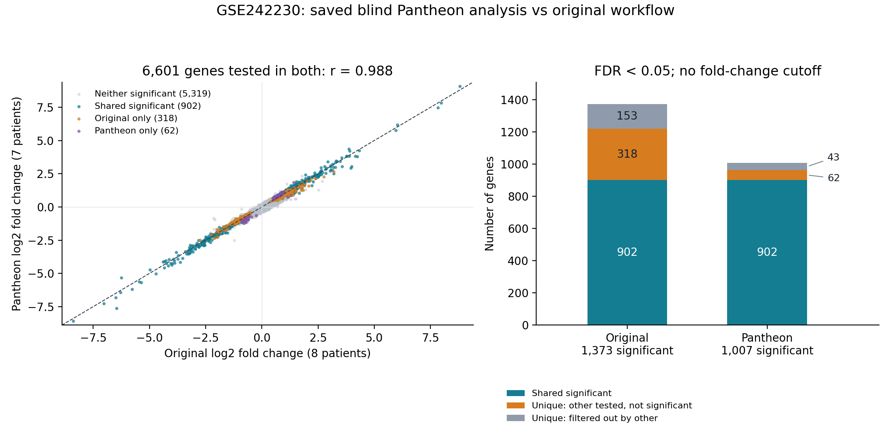

# Pantheon–PDAC evaluation

A small, reproducible comparison of an input-blinded, evaluator-assisted **PantheonOS analysis** with an existing workflow on **GSE242230** pancreatic ductal adenocarcinoma single-cell data. The biological question was: *Which genes differ between malignant epithelial cells and cells annotated as normal epithelial cells?*

Prepared by Cathy Liu with AI assistance. Pantheon generated its analysis; Codex handled evaluation setup, comparison and auditing. This compares analyses of **the same dataset**. It is not independent biological validation, a causal-target study, or validation of EFS.

## Main result

At **FDR < 0.05, without a fold-change cutoff**, the analyses share **902 significant genes**. Across **6,601 genes tested in both**, log2 fold changes have **Pearson r = 0.988** (unrounded: 0.9879749732771475; Spearman 0.980). All 1,282 commonly tested genes significant in either analysis agree in direction.

| | Existing reference | Pantheon primary |
|---|---:|---:|
| Paired patients | 8 | 7 |
| Malignant / normal-labelled cells | 1,983 / 318 | 1,856 / 249 |
| Method | Paired PyDESeq2 0.4.12 | Paired robust edgeR 4.4.0 quasi-likelihood |
| Genes tested | 7,686 | 6,720 |
| Significant genes | 1,373 | 1,007 |
| Shared significant | 902 | 902 |
| Unique significant | 471 | 105 |

Of the 471 reference-only discoveries, 153 were filtered out by Pantheon and 318 were tested but nonsignificant. Of the 105 Pantheon-only discoveries, 43 were filtered out by the reference and 62 were tested but nonsignificant. **Filtered out does not mean tested negative.** See the [shared](results/shared_significant_genes.tsv), [reference-only](results/original_only_significant_genes.tsv) and [Pantheon-only](results/pantheon_only_significant_genes.tsv) tables.

## How the blind round worked

Pantheon received original counts, author cell annotations, public sample metadata and the question above—no old scripts, results, expected genes or prescribed statistical method. Its [initial plan](protocol/blind_initial_plan.txt) was saved first. After dependency provisioning was offered without prescribing a method, it chose paired edgeR pseudobulk inference. Patients, rather than cells, were the biological replicates. The [methods and assistance record](docs/METHODS.md) explains the plan changes and the separate reference-reproduction session.

Before DE, Pantheon identified **wu16** as a composition concern: **HBB accounted for 80.30% of malignant pseudobulk counts**, and 103/127 labelled malignant cells had over 50% HBB counts. It recommended excluding the entire pair; the evaluator accepted this before results existed. Contamination or annotation error remains unproven. The eight-patient cohort was retained as a sensitivity analysis.

Both workflows required at least ten cells per group for paired eligibility. The reference also used ≥200 detected genes and ≤25% mitochondrial counts; those filters removed no epithelial cells. Pantheon used supplied eligible labels, nonzero counts and a separate composition review. Its primary cohort is the reference cohort minus wu16. Gene-abundance filters and statistical methods also differ. With the same eight patients and identical pseudobulk counts, edgeR found 912 discoveries; excluding wu16 increased this to 1,007. Exclusion also changes abundance filtering and refits normalization/dispersion, so it does not isolate one component. See [patient inclusion](results/patient_inclusion_comparison.tsv) and [sensitivity comparisons](results/sample_and_subtype_sensitivity_comparisons.tsv).

## Inspect or reproduce

- [Saved Pantheon analysis scripts](workflows/pantheon/outputs/analysis/code), including count preparation and edgeR inference.
- [Reference scripts](workflows/reference/reproduction/scripts): the saved path-only copies used in the fresh reproduction session.
- [Codex comparison script](scripts/compare_saved_analyses.py), [compact results](results) and [full comparison report](docs/SAVED_COMPARISON_REPORT.txt).
- [Reproduction instructions](docs/REPRODUCING.md), [public data downloads](docs/DATA.md) and [provenance](docs/PROVENANCE.md).

The compressed [comparison inputs](results/comparison_inputs.tar.gz) contain saved derived results and pseudobulks, enabling comparison without raw data or model credentials. Raw single-cell matrices, installed environments, credentials and private conversations/logs are excluded. Publication reused existing results; no statistical analysis was rerun for this repository.

## Limits

“Normal Epithelial” means author-annotated cells within tumor biopsies, not healthy-donor pancreas. The seven-patient primary is small and overwhelmingly classical-labelled (1,837 classical, 19 basal malignant cells). Sample selection, annotation, filtering and inference affect the gene lists. Agreement does not establish biological truth or causality. EFS was filtered before testing in both primary workflows and is not validated here.

Saved local replays reproduced the scientific outputs; new public wrappers have only been statically checked. The original environment snapshot reproduces saved results but is not a contemporaneous historical lock. This evaluates one assisted Pantheon configuration, not unattended reliability.

Sources: [GEO GSE242230](https://www.ncbi.nlm.nih.gov/geo/query/acc.cgi?acc=GSE242230), [original study](https://www.nature.com/articles/s41698-023-00455-z), [PantheonOS](https://pantheonos.stanford.edu/).
